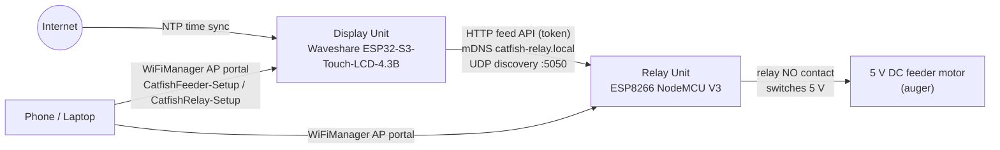

# Catfish Feeder

**An automatic catfish feeder: a 4.3-inch touch scheduler paired with a WiFi relay that pulses a 5 V auger motor — feed your fish on time, every time.**

[](https://github.com/mlger/smartfishfeeder/actions/workflows/firmware.yml)
[](LICENSE)

## What it is

Catfish Feeder is a two-board, self-hosted fish feeder. The **Display Unit** (Waveshare ESP32-S3-Touch-LCD-4.3B, 800x480 LVGL UI) runs a touch scheduler synced to NTP (Asia/Manila) and sends token-protected HTTP commands to a **Relay Unit** (ESP8266 NodeMCU V3) that briefly energizes a 5 V DC feeder motor through an optocoupler relay. No cloud account, no subscription — everything runs on your LAN, and the firmware can be flashed from a browser.

## Features

- Touch UI on a 4.3" 800x480 panel (LVGL 8.4): **Feed Now**, **Schedule**, **Settings**
- NTP time sync with Asia/Manila timezone (`PHT-8`, UTC+8, no DST)
- First-boot WiFi provisioning via WiFiManager captive portal (AP `CatfishFeeder-Setup`)
- Browser-based flashing (ESP Web Tools) — no toolchain install required
- ArduinoOTA updates on both units (relay: `catfish-relay.local`, display: `catfishfeeder.local`)
- Relay discovery via mDNS (`catfish-relay.local`) and UDP broadcast on port 5050
- Token-protected feed API (`POST /feed`, default token `catfish` — change it)
- **Servo / stepper feeding mechanisms** (v1.4.0+): switch the relay unit between DC motor, SG90-class servo sweep or A4988/DRV8825 stepper — same "feed for N seconds" API, configurable on the display unit — see [docs/api.md](docs/api.md)
- MQTT hub on the display unit with **Home Assistant auto-discovery**: HA button/sensors drive real feeds, feeder state (last/next feed, relay online) streams back — see [docs/mqtt.md](docs/mqtt.md)
- Built-in **web dashboard** on the display unit: feed, edit the schedule and update firmware from any phone browser — see [docs/dashboard.md](docs/dashboard.md)
- Fully documented: wiring, build, API, UI design pipeline, AI tooling

## Architecture



- **Display Unit** — ESP32-S3-WROOM-1-N16R8 (16 MB flash, 8 MB PSRAM), RGB565 800x480 panel, GT911 capacitive touch, CH422G IO expander. Keeps time via NTP, renders the schedule, discovers and commands the relay.
- **Relay Unit** — ESP8266 NodeMCU V3 driving a 5 V 1-channel optocoupler relay. Exposes `/health`, `/status`, `POST /feed`, `POST /config`; announces itself over mDNS and UDP; accepts ArduinoOTA uploads.
- **Power stage** — a 5 V >= 2 A supply feeds the relay contacts and motor (with a 1N4007 flyback diode). See [hardware](docs/hardware.md).

## Hardware bill of materials

| # | Item | Qty | Notes |
|---|------|-----|-------|
| 1 | Waveshare ESP32-S3-Touch-LCD-4.3B | 1 | ESP32-S3-WROOM-1-N16R8, 4.3" 800x480 RGB565, GT911 touch |
| 2 | ESP8266 NodeMCU V3 | 1 | Relay controller (amica/lolin V3, CH340 USB-serial) |
| 3 | 5 V 1-channel optocoupler relay module | 1 | Many boards are ACTIVE-LOW; handled by `RELAY_ACTIVE_LEVEL` in firmware config |
| 4 | 5 V DC feeder motor (auger/roller) | 1 | Auger screw, roller, or Archimedes screw mechanism |
| 5 | 1N4007 flyback diode | 1 | Across motor terminals, band (cathode) to motor + |
| 6 | 5 V power supply, >= 2 A | 1 | Powers relay unit + motor; size for motor stall current |
| 7 | Dupont jumpers + 20-22 AWG hook-up wire | — | Signal wiring and motor power leads |
| 8 | USB-C data cable, micro-USB data cable | 1+1 | Flashing and 5 V power for both units |
| 9 | IP-rated enclosure, cable glands | opt. | Splash protection near the tank |

Full wiring and assembly instructions: [docs/hardware.md](docs/hardware.md).

## Quickstart

### A. Flash from the browser (easiest)

1. Open the web flasher: **https://mlger.github.io/smartfishfeeder/** in Chrome or Edge (Web Serial required).
2. Connect the Display Unit with a USB-C data cable, click **Connect**, then **Install** — ESP Web Tools writes all four images (bootloader, partitions, boot_app0, firmware) at the correct offsets.
3. Repeat with the Relay Unit over micro-USB (single `firmware.bin` at `0x0`).
4. On first boot each unit opens a WiFiManager access point — join `CatfishFeeder-Setup` / `CatfishRelay-Setup` from your phone and pick your WiFi.

### B. Build and flash with PlatformIO

```sh
# one-time: install the CLI (or use VS Code + PlatformIO extension)
pip install -U platformio

git clone https://github.com/mlger/smartfishfeeder.git
cd smartfishfeeder

pio run -d firmware/display-unit -t upload     # ESP32-S3 4.3B (hold BOOT if upload won't sync)
pio run -d firmware/relay-unit -t upload       # ESP8266 NodeMCU V3
pio device monitor -b 115200                   # serial logs
```

Later, update the relay over the air instead of cable:

```sh
pio run -d firmware/relay-unit -t upload --upload-port catfish-relay.local
```

Details, offsets, and troubleshooting: [docs/firmware.md](docs/firmware.md).

## Documentation

| Document | Contents |
|----------|----------|
| [Hardware & wiring](docs/hardware.md) | BOM, wiring tables, power sizing, mounting, safety, feeding mechanisms |
| [Firmware guide](docs/firmware.md) | Prerequisites, build, flash (web/esptool/PIO), provisioning, config, OTA, troubleshooting |
| [HTTP & UDP API](docs/api.md) | `/feed`, `/status`, `/health`, `/config`, UDP discovery, mDNS, security notes |
| [MQTT & Home Assistant](docs/mqtt.md) | Topic map, HA discovery entities, commands, reconnection behaviour |
| [Web dashboard](docs/dashboard.md) | Phone dashboard, HTTP API, in-browser firmware updates |
| [Figma to LVGL](docs/figma-lvgl.md) | 800x480 UI design pipeline: Figma plugin, LVGL AI, design tokens |
| [AI tooling](docs/tooling.md) | Claude Code MCP servers, Figma Dev Mode MCP, Codespaces, CI, secrets hygiene |
| [Verified hardware notes](docs/notes/hardware-4.3b.md) | Pin-level source of truth for the 4.3B (verified against Waveshare demo) |

The docs site is served via GitHub Pages alongside the web flasher: https://mlger.github.io/smartfishfeeder/

## Repository map

```
smartfishfeeder/
├── firmware/
│   ├── display-unit/        # ESP32-S3 touch UI (LVGL 8.4): Feed Now / Schedule / Settings
│   │   ├── platformio.ini   # pioarduino 55.03.312 (Arduino core 3.x), 16 MB / qio_opi
│   │   ├── include/         # lv_conf.h, esp_panel_board_custom_conf.h (Waveshare board config)
│   │   ├── src/             # app code + Waveshare lvgl_v8_port.cpp/h
│   │   └── lib/             # vendored ESP32_Display_Panel 1.0.0, ESP32_IO_Expander 1.0.1, esp-lib-utils 0.1.2
│   └── relay-unit/          # ESP8266: HTTP API, UDP discovery, mDNS, ArduinoOTA
│       └── platformio.ini   # espressif8266@^4.2.1, nodemcuv2
├── web-flasher/             # ESP Web Tools v10 page deployed to GitHub Pages
├── docs/                    # documentation (this suite) + notes/
├── .github/workflows/       # firmware.yml: build both units, merge S3 bins, Pages deploy, v* releases
├── .devcontainer/           # Codespaces / devcontainer image with PlatformIO
├── .mcp.json                # Claude Code MCP servers: context7 + claude-mem
└── LICENSE                  # MIT + third-party notices
```

CI builds both firmwares on every push (ESP32-S3 factory image pre-merged at bootloader `0x0`, partitions `0x8000`, boot_app0 `0xe000`, firmware `0x10000`) for the web flasher, deploys the flasher to GitHub Pages, and attaches binaries to GitHub Releases on `v*` tags.

## Roadmap

- ~~MQTT client with Home Assistant auto-discovery~~ — shipped in v1.2.0 (hub on the display unit: feed button, pulse number, state sensors, LWT availability)
- ~~Web dashboard (beyond the relay unit's built-in page)~~ — shipped in v1.3.0 (display-unit dashboard: feed, schedule editor, firmware upload, JSON API)
- ~~Servo / stepper-based feeding mechanism option~~ — shipped in v1.4.0 (motor / servo sweep / stepper on the relay unit, additive EEPROM, editable from the display unit)
- Camera snapshot on each feed event
- ~~OTA updates for the display unit~~ — shipped in v1.1.0 (ArduinoOTA on both units, optional build-time password)
- Multi-tank / multi-relay support (one display unit driving several relays)

## Credits

- [Waveshare](https://www.waveshare.com) — ESP32-S3-Touch-LCD-4.3B demo package (board config, `lvgl_v8_port`), Apache-2.0/CC0
- [Espressif](https://www.espressif.com) — ESP32_Display_Panel, ESP32_IO_Expander, esp-lib-utils, Apache-2.0
- [LVGL](https://lvgl.io) — LVGL 8.4.0, MIT
- [pioarduino](https://github.com/pioarduino/platform-espressif32) — ESP32 platform for PlatformIO
- [WiFiManager](https://github.com/tzapu/WiFiManager) (tzapu), [ArduinoJson](https://github.com/bblanchon/ArduinoJson) (bblanchon)
- [ESP Web Tools](https://esphome.github.io/esp-web-tools/) — in-browser flashing

## License

MIT — see [LICENSE](LICENSE). Third-party components (Espressif panel libraries, LVGL, Waveshare demo code) remain under their own licenses, attributed in the same file.
